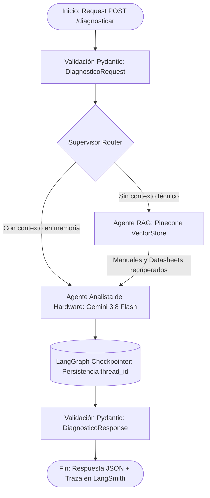

# 🛠️ The Intelligence System: Hardware Diagnostics & IT Support AI

Sistema multi-agente de grado de producción para el diagnóstico electrónico de hardware y soporte técnico a nivel componente. El sistema integra **RAG Híbrido (Pinecone)**, orquestación asíncrona con **LangGraph**, persistencia de sesiones mediante **Checkpointer**, validación estricta de esquemas con **Pydantic v2** y observabilidad en tiempo real con **LangSmith**.

---

## 🏗️ Arquitectura y Flujo del Grafo de Agentes

El flujo de ejecución está orquestado mediante un Supervisor en LangGraph que evalúa y delega las tareas de forma dinámica:



---

## 🚀 Requisitos Técnicos

- **Python:** 3.12+
- **Framework API:** FastAPI + Uvicorn (100% asíncrono `async/await`)
- **Orquestación & LLMs:** LangGraph + LangChain (`gemini-3.8-flash`)
- **Base de Datos Vectorial:** Pinecone Serverless
- **Observabilidad:** LangSmith Tracing (`LANGCHAIN_TRACING_V2=true`)

---

## ⚙️ Configuración del Entorno

### 1. Clonar el repositorio y configurar el entorno virtual

```bash
python -m venv venv
source venv/Scripts/activate  # En Windows PowerShell: .\venv\Scripts\activate
pip install -r requirements.txt
```

### 2. Crear el archivo `.env`

Crea un archivo llamado `.env` en la raíz del proyecto con las siguientes credenciales:

```env
PINECONE_API_KEY=tu_api_key_pinecone
PINECONE_INDEX_NAME=final
LANGSMITH_API_KEY=tu_api_key_langsmith
LANGSMITH_TRACING=true
LANGSMITH_PROJECT=intelligence-hardware-support
GEMINI_API_KEY=tu_api_key_gemini
GEMINI_MODEL=gemini-3.8-flash
```

---

## ▶️ Despliegue Local (1 Comando)

El proyecto cuenta con un script de arranque unificado (`run.sh`) para levantar todo el entorno de producción localmente:

```bash
bash run.sh
```

**Alternativa directa en Windows PowerShell:**

```powershell
python -m uvicorn src.api.app:app --reload
```

Una vez iniciado el servidor, accede a la documentación interactiva de la API (Swagger UI) en:
👉 <http://127.0.0.1:8000/docs>

---

## 🧪 Ejemplo de Prueba (JSON Request)

Para realizar una consulta de diagnóstico técnico en Swagger (`POST /diagnosticar`):

```json
{
  "dispositivo": "Laptop Lenovo ThinkPad",
  "sintomas": "No enciende la pantalla y parpadea el LED de encendido",
  "codigo_error": "LED_BLINK_3"
}
```

---

## 📊 Observabilidad y Trazabilidad

El sistema registra de manera automática cada invocación, latencia y uso de tokens en LangSmith bajo el proyecto configurado (`intelligence-hardware-support`), permitiendo auditar el comportamiento del RAG y las respuestas del modelo en distintas sesiones de usuario (`thread_id`).